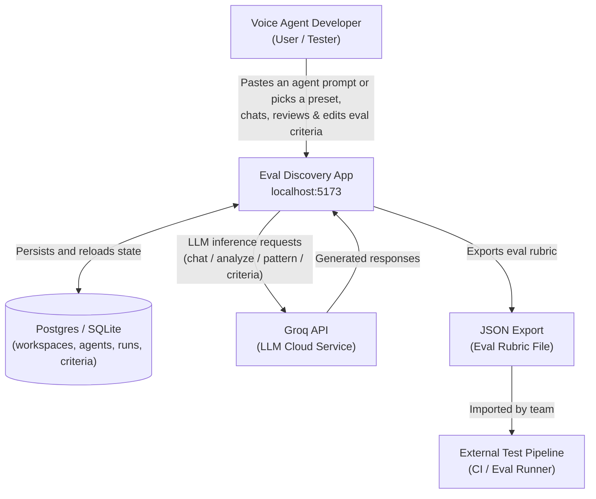
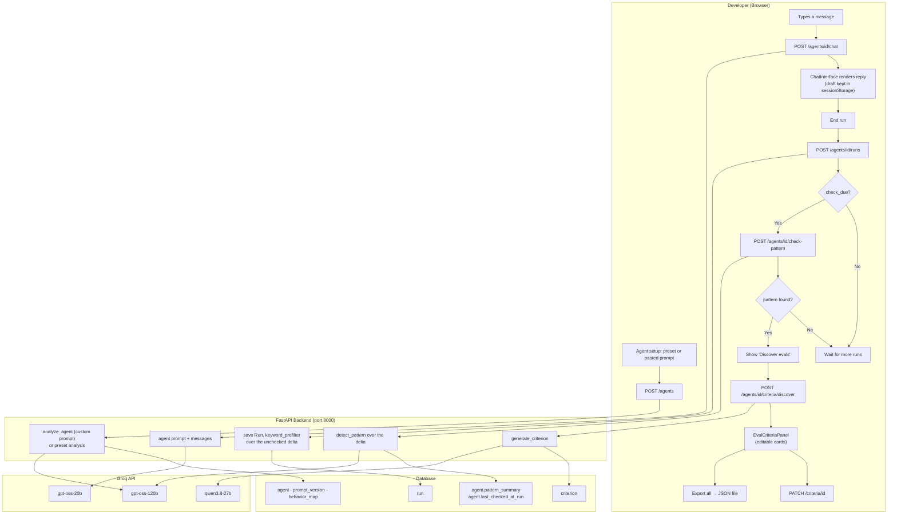
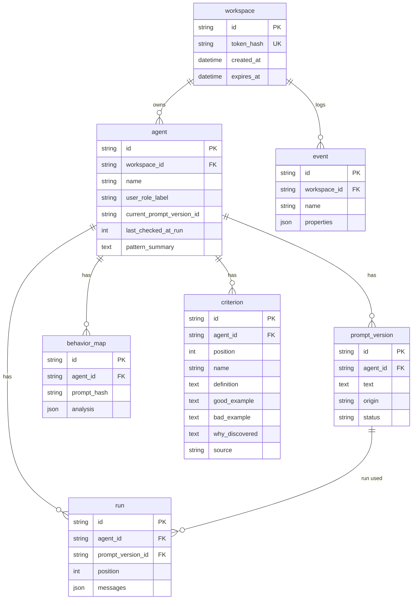
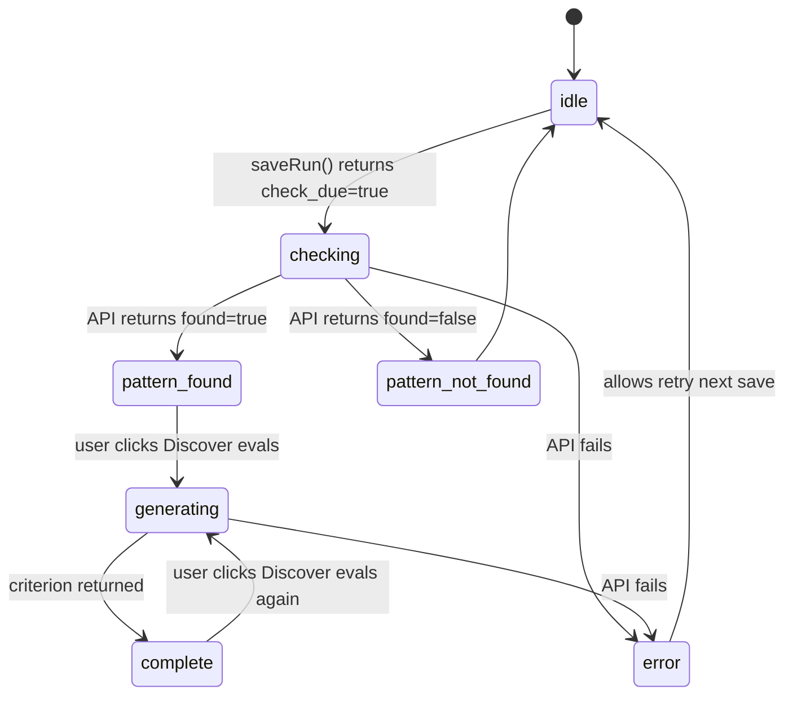

# Eval Discovery — System Architecture

> **Audience:** This document serves both executives and technical stakeholders.
> Executives: focus on the [System Overview](#1-system-overview) and [Context Diagram](#31-system-context-diagram).
> Engineers: the [Component Diagram](#33-component-diagram), [Data Flow Diagram](#32-data-flow-diagram) and [Data Model](#4-data-model) contain the implementation details.

---

## 1. System Overview

**Eval Discovery** is a web application that accelerates the quality-assurance process for conversational AI ("voice agent") products. Developers who build voice agents — like sales bots or support agents — must test them against real-world conversation patterns, then write rubrics that describe what "good" looks like.

Today that process is manual and slow. Eval Discovery automates it:

- A developer pastes **any agent's system prompt** (or picks a built-in preset) and plays the user role in conversations with that agent
- The system watches for repeated testing patterns across those conversations
- Once a pattern is detected, the system uses a large language model to generate an evaluation rubric, grounded in real conversation evidence
- The developer reviews, edits, and exports the rubric as JSON for use in automated test pipelines

**Business Value:**
- Reduces time-to-rubric from hours of manual analysis to minutes
- Ensures rubrics are grounded in actual conversation data, not guesswork
- Creates an auditable artifact (JSON) that integrates with existing test infrastructure

---

## 2. Architecture Type

**Monolithic Two-Tier Web Application** with a relational database and LLM backend services

| Layer | Technology | Role |
|-------|-----------|------|
| Frontend | React 19 + Vite + Tailwind CSS | User interface, chat draft, hydration from the server |
| Backend | Python FastAPI | Routing, workspace auth, limits, prompt engineering, LLM orchestration |
| Persistence | SQLAlchemy 2 + Alembic on Postgres (SQLite for local dev and tests) | Workspaces, agents, runs, criteria, events |
| LLM Services | Groq API (3 models) | Agent simulation, prompt analysis and pattern detection, criteria generation |

---

## 3. Architecture Diagrams

### 3.1 System Context Diagram

Shows the system as a whole and every external actor it communicates with.



**Key relationships:**
- The developer is both the conversation participant (playing the user role) and the rubric author
- Groq and the database are the only runtime dependencies — there is no auth service; identity is an anonymous workspace token
- The output (JSON rubric) flows into the team's broader test infrastructure

---

### 3.2 Data Flow Diagram

Shows how data moves through the system from agent setup to the final eval rubric export.



**Where state lives:**

| Data | Location | Lifetime |
|------|----------|----------|
| Workspace token, active agent id | Browser `localStorage` (`ed_token`, `ed_agent_id`) | Until the workspace expires or is deleted |
| Chat draft of the run in progress | Browser `sessionStorage`, one key per agent | Until End run saves it or the tab session ends |
| Workspace, agents, prompt versions, behavior maps, runs, criteria, events | Database | 30 days from workspace creation |
| Pattern-detection UI state | Derived on load from the server (see [5](#5-pattern-detection-state-machine)) | Not stored |

---

### 3.3 Component Diagram

Internal structure of both the frontend application and backend API.

```mermaid
graph TB
    subgraph Browser["Browser — React App (port 5173)"]
        direction TB
        Main["main.jsx<br/>(React root)"]
        App["App.jsx<br/>(Layout orchestrator)"]
        Hook["useSession.js<br/>(Hydrates from GET state; run, pattern and criteria logic)"]
        ApiClient["api.js<br/>(Fetch client · adds X-Workspace-Token · creates the workspace on first call)"]
        Lib["lib/workspace.js · draft · patternState<br/>(token storage · chat draft · state derivation)"]

        subgraph Components["UI Components"]
            Setup["AgentSetup.jsx<br/>Preset picker · paste prompt · role label"]
            Header["Header<br/>PatternBadge · Discover evals btn · History + Eval criteria toggles"]
            Chat["ChatInterface.jsx<br/>Message list · Input bar · Typing animation"]
            Eval["EvalCriteriaPanel.jsx<br/>Editable criterion cards · Export · Add"]
            History["HistoryPanel.jsx<br/>Completed run transcripts · slide-in drawer"]
            Controls["RunControls.jsx<br/>End run button · progress hint"]
        end

        Main --> App
        App --> Hook
        Hook --> ApiClient
        Hook --> Lib
        ApiClient --> Lib
        App --> Setup
        App --> Header
        App --> Chat
        App --> Eval
        App --> History
        App --> Controls
    end

    subgraph BackendAPI["FastAPI Backend (port 8000)"]
        direction TB
        FastAPI["main.py<br/>(CORS · routers · startup purge of expired workspaces)"]

        subgraph Routers["api/ — routers"]
            WsRouter["workspaces.py<br/>POST /workspaces · DELETE /workspaces/me"]
            AgentRouter["agents.py<br/>GET /presets · POST /agents · GET state · POST chat"]
            RunRouter["runs.py<br/>POST runs · POST check-pattern"]
            CriteriaRouter["criteria.py<br/>POST discover · POST criteria · PATCH criteria"]
        end

        ApiSupport["api/deps.py · limits.py · schemas.py<br/>(workspace auth · quotas and rate limiter · strict Pydantic schemas)"]

        subgraph Core["core/ — pure logic, no web or DB imports"]
            Config["config.py<br/>(AgentConfig · AgentAnalysis · Behavior · presets · limits)"]
            Analyze["analyze.py<br/>(prompt → behavior map)"]
            Pattern["pattern.py<br/>(keyword_prefilter · detect_pattern)"]
            Criteria["criteria.py<br/>(generate_criterion)"]
            Prompts["prompts.py<br/>(prompt builders · delimiter neutralizing)"]
        end

        subgraph Db["db/ — persistence"]
            DbModels["models.py · session.py"]
            DbHelpers["agents.py · workspaces.py · events.py"]
        end

        GroqClient["groq_client.py<br/>(API wrapper · model constants · think-block stripping)"]
        Utils["utils.py<br/>(JSON extraction from LLM output)"]

        FastAPI --> WsRouter
        FastAPI --> AgentRouter
        FastAPI --> RunRouter
        FastAPI --> CriteriaRouter
        Routers --> ApiSupport
        Routers --> Core
        Routers --> DbHelpers
        DbHelpers --> DbModels
        Core --> Prompts
        Core --> GroqClient
        Core --> Utils
        AgentRouter --> GroqClient
    end

    subgraph GroqAPI["Groq API"]
        Chat20["openai/gpt-oss-20b<br/>(plays the agent under test)"]
        GPT["openai/gpt-oss-120b<br/>(prompt analysis · pattern detection)"]
        Qwen["qwen/qwen3.8-27b<br/>(criteria generation)"]
    end

    DB[("Postgres / SQLite")]

    ApiClient -->|"HTTP / JSON"| FastAPI
    DbModels --> DB
    GroqClient --> Chat20
    GroqClient --> GPT
    GroqClient --> Qwen
```



---

## 4. Data Model

Seven tables (Alembic migration `migrations/versions/0001_foundation.py`). Ids are string UUIDs and timestamps are naive UTC so SQLite and Postgres behave alike. Every foreign key is `ON DELETE CASCADE`.



| Table | Notes |
|-------|-------|
| `workspace` | Only the SHA-256 hash of the token is stored (`token_hash`, unique). `expires_at` is 30 days after creation. |
| `agent` | `current_prompt_version_id` is deliberately not a foreign key (it would be circular with `prompt_version`). `last_checked_at_run` is the delta cursor; `pattern_summary` holds the unconsumed pattern and is cleared when a criterion is discovered from it. |
| `prompt_version` | Phase 1 writes exactly one per agent (`origin = "initial"`, `status = "promoted"`); the table exists so later phases can version prompts. |
| `behavior_map` | `analysis` JSON: `user_role_label`, `behaviors` (name, description, trigger terms) and `starter_messages`. `prompt_hash` ties it to the prompt text it was built from. |
| `run` | One saved conversation. `position` is 1-based per agent and unique with `agent_id`, so two concurrent saves cannot take the same slot (the loser gets a 409). `messages` is the transcript JSON. |
| `criterion` | `source` is `discovered` or `manual`; `position` orders them. |
| `event` | Product event log, see [6.5](#65-events). |

---

## 5. Pattern-Detection State Machine

The UI runs an explicit finite-state machine for the pattern-detection lifecycle. It is **no longer persisted**: on load the frontend derives the starting state from what the server returns (`derivePatternState`): a stored `pattern_summary` gives `pattern_found`, otherwise any existing criteria give `complete`, otherwise `idle`. States such as `checking`, `generating` and `error` are transient and live only in the page.



The decision to check is made by the server, not the browser: `check_due` in the save-run response is true when at least 2 runs are new since the last check **and** a behavior trigger term appears in user messages of at least 2 of them (see [6.3](#63-delta-batching-and-keyword-pre-filter)).

---

## 6. Key Design Decisions

### 6.1 Anonymous Workspaces

There are no accounts. The first API call (`POST /workspaces`) returns a random token; the browser keeps it in `localStorage` and sends it as `X-Workspace-Token`. The backend stores only its SHA-256 hash, and every agent, run and criterion is reached through a workspace the token proves ownership of (a foreign or missing agent is a 404, an unknown or expired token a 401).

**Why:** A portfolio-scale tool should not need sign-up to try, but state must survive reloads and return visits. A bearer token gives that with no identity data to protect.

**Retention:** a workspace expires 30 days after creation. Expired workspaces are purged when the backend starts (one pass in the app lifespan), and `DELETE /workspaces/me` removes a workspace and all its data at once.

### 6.2 Agent Config and Presets

An agent is a name, a system prompt, a user-role label and an analysis. Presets (`alex-sales`, `support`, `booking`) **ship their analysis** with them, so choosing one needs no LLM call. A pasted prompt is analyzed once by `analyze_agent` (gpt-oss-120b), which returns 3–8 behaviors with trigger terms, the role label and exactly three starter messages; the result is validated strictly and stored as a `behavior_map`.

**Why:** This replaces the earlier hardcoded keyword list that only suited one persona. Testing logic is now data derived per agent.

### 6.3 Delta Batching and Keyword Pre-filter

Each agent keeps `last_checked_at_run`. A pattern check only sends runs with `position` above it, and after a successful check it advances only to the last run it analyzed, so a run saved during the LLM call stays in the next delta. Before offering a check, the server runs `keyword_prefilter`: some trigger term from the agent's behavior map must appear in user messages of at least 2 different new runs.

**Why:** Fewer pointless LLM calls and smaller prompts as a session grows, with no keyword list baked into the code.

### 6.4 Prompt-Injection Handling

Pasted agent prompts, transcripts and pattern summaries are untrusted. Prompt builders wrap them in delimiter tags (`<agent_prompt>`, `<transcripts>`, `<pattern_summary>`), neutralize any such tag inside the content (the angle brackets are escaped, so it cannot close the wrapper), and the system text states that tagged content is data to analyze, never instructions.

### 6.5 Events

A minimal product event log records `agent_created`, `run_saved`, `loop_detected` and `criterion_created` with small property dicts. Writes go through `try_log_event`, which is best-effort: a failure rolls back, is logged, and never fails the user's request.

### 6.6 Limits

| Limit | Value |
|-------|-------|
| Agents per workspace | 5 (also re-checked inside the create transaction) |
| Runs per workspace | 50 |
| System prompt length | 4000 characters |
| Message length / messages per request | 2000 characters / 40 |
| LLM-backed calls | 30 per minute per client IP (in-memory sliding window, per process) |

The rate limiter keys on the client IP, so behind a reverse proxy uvicorn must run with `--proxy-headers` and `--forwarded-allow-ips` (see [8](#8-development--deployment)). State is per process: it resets on restart and is not shared across instances.

### 6.7 Model Assignments

| Task | Model | Reasoning |
|------|-------|-----------|
| Conversational chat (plays the agent under test) | openai/gpt-oss-20b | Low latency for interactive chat; 20B is enough for persona roleplay |
| Prompt analysis and pattern detection | openai/gpt-oss-120b | Higher accuracy for classification over a long prompt or several transcripts |
| Structured criteria generation | qwen/qwen3.8-27b | Reasoning-capable model for grounded, structured JSON rubrics (reasoning output hidden) |

---

## 7. Backend API Reference

**Base URL:** `http://localhost:8000`. Every endpoint except `POST /workspaces` and `GET /presets` requires the `X-Workspace-Token` header.

| Endpoint | Method | Purpose |
|----------|--------|---------|
| `/workspaces` | POST | Create a workspace; returns `{token}` |
| `/workspaces/me` | DELETE | Delete the workspace and all its data (204) |
| `/presets` | GET | The 3 built-in agent presets |
| `/agents` | POST | Create an agent from `{preset_id}` or `{name, system_prompt, user_role_label?}` |
| `/agents/{id}/state` | GET | Agent, runs, criteria, pattern summary, run count, last checked run |
| `/agents/{id}/chat` | POST | `{messages}` → `{reply}` from the agent under test |
| `/agents/{id}/runs` | POST | Save a run (3–40 messages); returns `{run, run_count, check_due}` |
| `/agents/{id}/check-pattern` | POST | Check the unchecked delta; returns `{found, pattern_summary}` |
| `/agents/{id}/criteria/discover` | POST | Generate a criterion from the stored pattern (409 if none) |
| `/agents/{id}/criteria` | POST | Add a criterion manually |
| `/criteria/{id}` | PATCH | Edit a criterion (partial update) |

**Error codes:** `400` nothing or too little to check, `401` unknown or expired token, `404` agent or criterion not found in this workspace, `409` run-save race or no pattern to build from, `422` invalid input, `429` quota or rate limit, `502` upstream LLM failure.

---

## 8. Development & Deployment

### Project Structure

```
eval-discovery/
├── backend/
│   ├── main.py               # App init, CORS, routers, startup purge
│   ├── api/                  # Routers (workspaces, agents, runs, criteria), deps, limits, schemas
│   ├── core/                 # Pure logic: config + presets, analyze, pattern, criteria, prompts
│   ├── db/                   # SQLAlchemy models, session, agent/workspace/event helpers
│   ├── groq_client.py        # Groq API wrapper, model constants
│   └── utils.py              # JSON extraction from LLM output
├── migrations/               # Alembic environment and versions
├── alembic.ini
├── frontend/src/             # App.jsx, api.js, hooks/useSession.js, components/, lib/
├── tests/                    # pytest suite
├── docs/                     # This document, specs and plans
├── docker-compose.yml        # Local Postgres 16
├── Procfile                  # Render start command
├── requirements.txt
└── README.md
```

### Local Development

```bash
# Terminal 1 — Backend
pip install -r requirements.txt
cp .env.example .env       # set GROQ_API_KEY
alembic upgrade head       # SQLite ./dev.db unless DATABASE_URL is set
uvicorn backend.main:app --reload    # http://localhost:8000

# Optional: local Postgres (credentials match .env.example)
docker compose up -d

# Terminal 2 — Frontend
cd frontend
npm install
npm run dev                # http://localhost:5173
```

### Environment Variables

| Variable | Required | Description |
|----------|---------|-------------|
| `GROQ_API_KEY` | Yes | API key from console.groq.com |
| `DATABASE_URL` | In production | `postgresql://…` (a `postgres://` URL is normalized to the psycopg driver). Unset means SQLite at `./dev.db` |
| `ALLOWED_ORIGINS` | In production | Comma-separated CORS origins; default `http://localhost:5173` |
| `VITE_API_URL` | Frontend build | Backend base URL baked into the frontend; default `http://localhost:8000` |

### Running Tests

```bash
python -m pytest tests -q
cd frontend && npm test && npm run lint && npm run build
```

### Deployment

> **Live Postgres has not been exercised.** The schema was reviewed offline (`alembic upgrade head --sql` and the models compiled against the Postgres dialect, plus a foreign-key-enforced delete check on SQLite). Nothing has run against a real Postgres server. Verify first on deploy: `alembic upgrade head` succeeds, `POST /workspaces` returns a token, `GET /presets` returns 3 presets, and deleting a workspace with runs works.

- **Backend (Render web service):** add a Postgres instance (check the provider's current free-tier terms first), set `DATABASE_URL`, `ALLOWED_ORIGINS` and `GROQ_API_KEY`, and use the start command from the `Procfile`:

  ```
  alembic upgrade head && uvicorn backend.main:app --host 0.0.0.0 --port $PORT --proxy-headers --forwarded-allow-ips="*"
  ```

  Migrations run on every start. `--proxy-headers` makes uvicorn read `X-Forwarded-For`; without it every request appears to come from Render's proxy and the per-IP limiter would throttle all users together. `--forwarded-allow-ips="*"` is acceptable on Render because a single trusted proxy sits in front of the container and is the only way in. On a host where clients can reach uvicorn directly, `*` lets any client spoof its IP and bypass the limiter, so list the proxy's address instead.
- **Frontend (Cloudflare Worker, static assets):** rebuild with `VITE_API_URL=<backend url> npm run build`, then deploy `frontend/dist`.
- No CI/CD pipeline is configured.

---

## 9. Roadmap

Saved tests, replay, judging, suggested prompt fixes and the later phases are not implemented. They are described in [docs/superpowers/specs/2026-11-21-agent-ready-eval-flywheel-design.md](superpowers/specs/2026-11-21-agent-ready-eval-flywheel-design.md).

---

*Updated November 2026 for the persisted, agent-ready architecture (Phase 1). For questions, see the project README or open an issue.*
