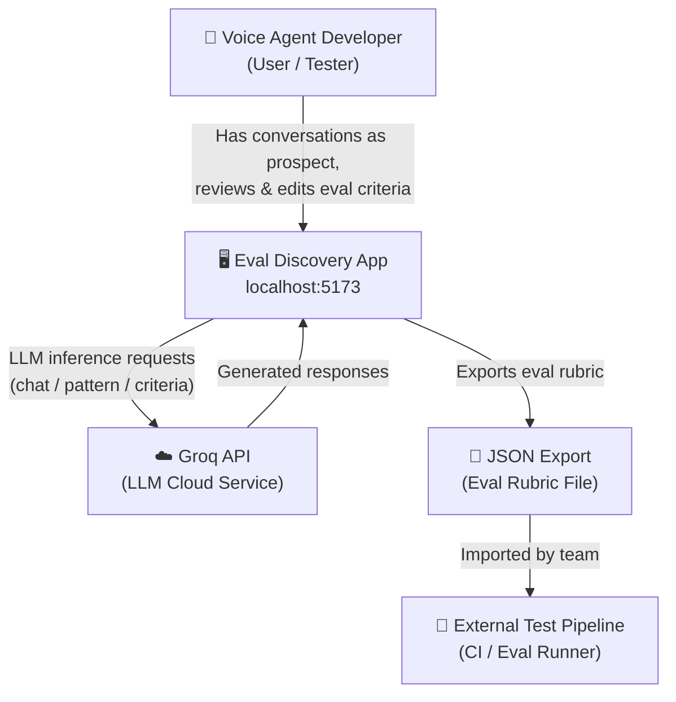
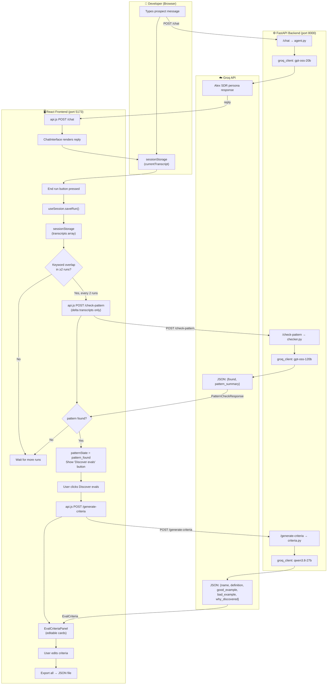
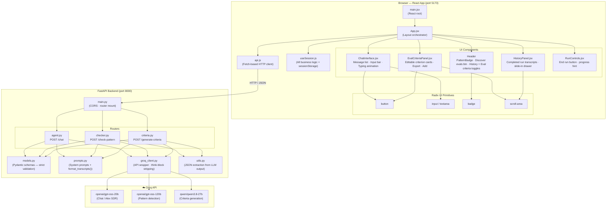
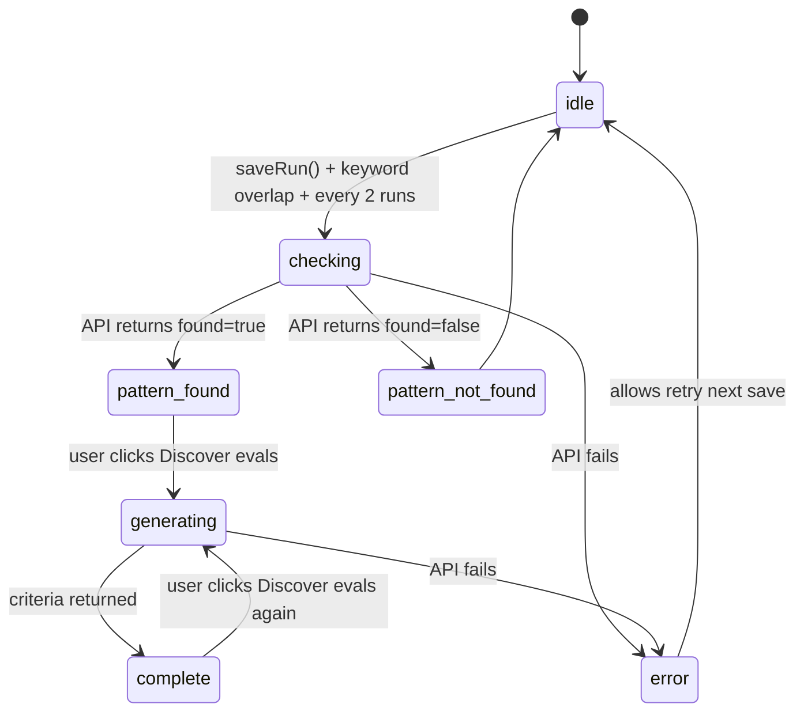

# Eval Discovery — System Architecture

> **Audience:** This document serves both executives and technical stakeholders.
> Executives: focus on the [System Overview](#1-system-overview) and [Context Diagram](#31-system-context-diagram).
> Engineers: the [Component Diagram](#33-component-diagram) and [Data Flow Diagram](#32-data-flow-diagram) contain full implementation details.

---

## 1. System Overview

**Eval Discovery** is a web application that accelerates the quality-assurance process for conversational AI ("voice agent") products. Developers who build voice agents — like sales bots or support agents — must test them against real-world conversation patterns, then write rubrics that describe what "good" looks like.

Today that process is manual and slow. Eval Discovery automates it:

- A developer plays the role of a prospect/customer and has repeated conversations with the AI agent
- The system watches for repeated testing patterns across those conversations
- Once a pattern is detected, the system uses a large language model to generate an evaluation rubric, grounded in real conversation evidence
- The developer reviews, edits, and exports the rubric as JSON for use in automated test pipelines

**Business Value:**
- Reduces time-to-rubric from hours of manual analysis to minutes
- Ensures rubrics are grounded in actual conversation data, not guesswork
- Creates an auditable artifact (JSON) that integrates with existing test infrastructure

---

## 2. Architecture Type

**Monolithic Two-Tier Web Application** with LLM backend services

| Layer | Technology | Role |
|-------|-----------|------|
| Frontend | React 19 + Vite + Tailwind CSS | User interface, session state, pattern-trigger logic |
| Backend | Python FastAPI | Request routing, prompt engineering, LLM orchestration |
| LLM Services | Groq API (3 models) | Chat simulation, pattern detection, criteria generation |

---

## 3. Architecture Diagrams

### 3.1 System Context Diagram

Shows the system as a whole and every external actor it communicates with.



**Key relationships:**
- The developer is both the conversation participant (as a human prospect) and the rubric author
- Groq is the only external dependency at runtime — no database, no auth service
- The output (JSON rubric) flows into the team's broader test infrastructure

---

### 3.2 Data Flow Diagram

Shows how data moves through the system from initial user input to final eval rubric export.



**Data stores (all client-side, session-scoped):**

| Key | Contents | Lifetime |
|-----|---------|---------|
| `currentTranscript` | Messages in current run | Cleared on End run |
| `transcripts` | All completed run arrays | Full session |
| `evalCriteria` | Generated + edited criteria | Full session |
| `patternState` | FSM state string | Full session |
| `patternSummary` | LLM-generated summary text | Full session |
| `lastCheckedAtRun` | Index for delta slicing | Full session |

---

### 3.3 Component Diagram

Internal structure of both the frontend application and backend API.



---

## 4. Key Design Decisions

### 4.1 Three-Model Strategy

Each task is assigned the most cost-effective model for its complexity:

| Task | Model | Reasoning |
|------|-------|-----------|
| Conversational chat (Alex SDR) | openai/gpt-oss-20b | Low latency needed for interactive chat; 20B is sufficient for persona roleplay |
| Pattern detection across transcripts | gpt-oss-120b | High-accuracy classification over long context; quality matters here |
| Structured criteria generation | qwen/qwen3.8-27b | Reasoning-capable model needed to generate grounded, structured JSON rubrics |

### 4.2 Client-Side State (sessionStorage)

All application state lives in the browser's `sessionStorage`. There is intentionally no database.

**Why:** The tool is designed for interactive, single-session exploration. Persisting to a server would add infrastructure complexity with no benefit for the current use case. The JSON export mechanism provides durable output when needed.

### 4.3 Delta Batching for Pattern Detection

When the frontend sends transcripts for pattern analysis, it only sends the _new_ transcripts since the last check (a delta slice), not the full history.

**Why:** Reduces Groq API token usage and latency as the session grows. The backend receives enough context to detect patterns without redundant data.

### 4.4 Keyword Pre-filter

Before calling the backend for pattern analysis, the frontend checks whether any of 38 domain-specific keywords (pricing, objections, competitors, etc.) appear in ≥2 different run transcripts. If not, the API call is skipped entirely.

**Why:** Eliminates pointless API calls early in a session when there is not yet meaningful data to analyze.

### 4.5 Pattern State Machine

The system uses an explicit finite-state machine for pattern detection lifecycle:



---

## 5. Backend API Reference

**Base URL:** `http://localhost:8000`

| Endpoint | Method | Request | Response | Purpose |
|----------|--------|---------|---------|---------|
| `/chat` | POST | `{messages: [{role, content}]}` | `{reply: string}` | Stream one Alex SDR reply |
| `/check-pattern` | POST | `{transcripts: [[{role,content}]]}` | `{found: bool, pattern_summary: string}` | Detect repeated testing pattern |
| `/generate-criteria` | POST | `{pattern_summary: string}` | `{name, definition, good_example, bad_example, why_discovered}` | Generate one eval criterion |

**Error codes:** `400` for invalid input, `502` for upstream LLM failures.

---

## 6. Project Structure

```
eval-discovery/
├── backend/                  # Python FastAPI application
│   ├── main.py               # App init, CORS, router registration
│   ├── agent.py              # POST /chat — Alex SDR chatbot
│   ├── checker.py            # POST /check-pattern — transcript analysis
│   ├── criteria.py           # POST /generate-criteria — rubric generation
│   ├── groq_client.py        # Groq API wrapper, model constants
│   ├── models.py             # Pydantic request/response schemas
│   ├── prompts.py            # System prompts + transcript formatter
│   └── utils.py              # JSON extraction from LLM output
│
├── frontend/                 # React + Vite application
│   └── src/
│       ├── App.jsx           # Root component, layout, global handlers
│       ├── api.js            # HTTP client (3 fetch wrappers)
│       ├── hooks/
│       │   └── useSession.js # All state: messages, runs, pattern FSM
│       └── components/
│           ├── ChatInterface.jsx      # Message thread + input bar
│           ├── EvalCriteriaPanel.jsx  # Editable criteria cards (right)
│           ├── HistoryPanel.jsx       # Completed run drawer (left)
│           ├── RunControls.jsx        # End run button footer
│           └── ui/                    # Radix primitive wrappers
│
├── tests/                    # pytest test suite (7 files)
├── docs/
│   └── ARCHITECTURE.md       # This document
├── requirements.txt          # Python dependencies
└── README.md                 # Quick-start guide
```

---

## 7. Development & Deployment

### Local Development

```bash
# Terminal 1 — Backend
pip install -r requirements.txt
cp .env.example .env       # add GROQ_API_KEY
uvicorn backend.main:app --reload    # http://localhost:8000

# Terminal 2 — Frontend
cd frontend
npm install
npm run dev                # http://localhost:5173
```

### Environment Variables

| Variable | Required | Description |
|----------|---------|-------------|
| `GROQ_API_KEY` | Yes | API key from console.groq.com |

### Running Tests

```bash
pytest tests/ -v
```

### Production Build

```bash
cd frontend && npm run build    # Outputs to frontend/dist/
```

No containerization or CI/CD pipeline is currently configured.

---

*Generated from source: March 2026. For questions, see the project README or open an issue.*
